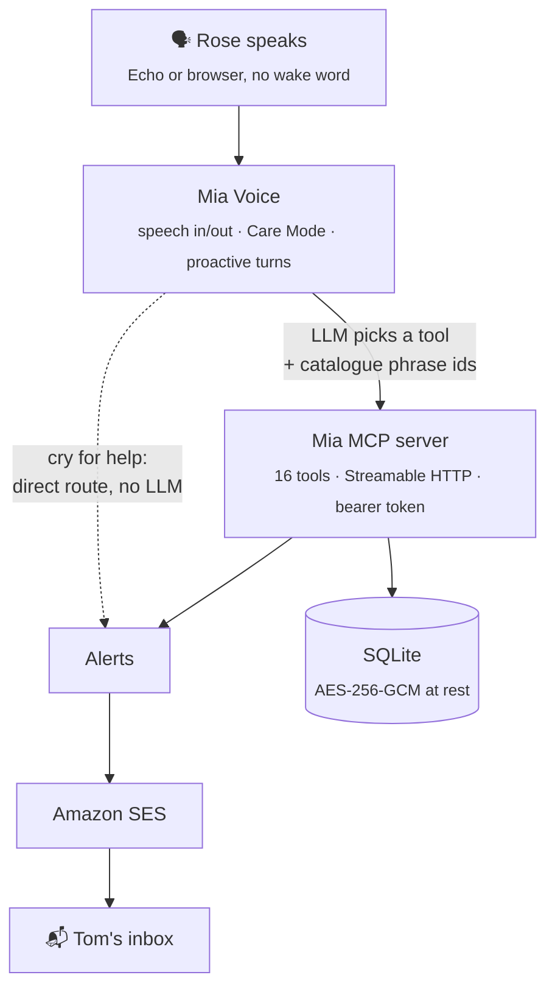

<div align="center">

# Mia

**A memory & care companion for Alexa+, for people living with dementia at home.**

Mia knows the day, the pills and the people. It answers the same question the same kind way every time, speaks first when it matters, and tells the family when something is wrong.

[](LICENSE)


[How it works](#how-it-works) · [Quick start](#quick-start) · [Safety](#safety-by-design) · [Privacy](#privacy) · [Status](#status--whats-next) · [Docs](#docs)

</div>

---

## Why Mia

Rose Whitaker is 81 and lives alone with Alzheimer's. Her son Tom looks after her from two hours away. *(Rose and Tom are fictional, see the [persona](docs/persona/rose.md).)*

A general voice assistant guesses, forgets and waits to be called by name. Someone living with dementia needs the opposite: answers that come only from what the family entered, the same calm words every time, and a companion that speaks first. Mia covers the five hardest parts of Rose's day:

| | Need | What Mia does |
|---|---|---|
| 💊 | **Medication** | "Did I take my pills?" is answered from the log, never from memory. A second dose is blocked kindly. Pills taken twice alert Tom. |
| 📅 | **Orientation** | Today's day, appointments and group days. On leaving, Mia goes through a checklist and checks the weather. |
| 🌙 | **Sleep** | At 2 a.m. a confused question gets the same calm answer: it's night, you're safe, go back to sleep. |
| 🫶 | **Anxiety** | Repeated questions get the same kind answer. Mia never says "you already asked that". |
| 👋 | **Loneliness** | Mia speaks first at agreed times: pills, time to leave, bedtime, an afternoon chat. |

When something is wrong, such as a fall, a cry for help or a health question Mia must not answer, **Tom gets an email within seconds**.

Mia started at the [Build, Ship, Shape: Amazon Developer Hackathon](https://amazonappdev2026.devpost.com/) (October 2026) as an exploration of what a care companion on Alexa+ could be. It is a working prototype, see [Status & what's next](#status--whats-next).

## What's in the box

- **Mia MCP server**: 16 tools over Streamable HTTP with bearer-token auth.
- **Mia Voice**, a browser simulator of an Echo with **Care Mode**. Care topics reach Mia without its name, and Mia speaks first at agreed times. Today's Alexa+ add-ons cannot do this; see the [Care Mode proposal](docs/project/care-mode-proposal.md).
- **Alexa skill bridge**: a German classic custom skill that reaches the same brain from an Echo.
- **Alarm email via Amazon SES**: medium and high alerts go to the carer.
- **AWS deployment**: a single small server in Frankfurt (EC2 + Caddy + SES), see [`deploy/aws`](deploy/aws/README.md).
- **English and German**, with every spoken sentence from a reviewed catalogue.

<details>
<summary><b>The 16 MCP tools</b></summary>

| Area | Tools |
|---|---|
| Medication | `get_medication_status`, `confirm_medication` |
| Day & appointments | `get_today`, `get_next_appointment`, `get_preparation_steps` (incl. weather) |
| Outings | `report_leaving`, `report_home` |
| People | `who_is` |
| Comfort & contact | `comfort_me`, `night_reassurance`, `chat_about_life`, `request_call` |
| Carer escalation | `ask_carer_about_health`, `report_problem` |
| Everyday | `play_music`, `repeat_last` |

</details>

## How it works



**"Claude picks, doesn't write."** The language model never writes a sentence that Rose hears. It only chooses which tool runs and which catalogue phrases come before or after. Every fact comes from a tool, and every sentence comes from the template catalogue in [`packages/shared/src/i18n`](packages/shared/src/i18n). Plain pill questions and cries for help skip the model entirely.

| Package | Role |
|---|---|
| [`packages/shared`](packages/shared) | Domain logic (medication, day, clock, proactive timing), distress detection, i18n catalogue, seed profiles |
| [`packages/mcp-server`](packages/mcp-server) | The MCP server and its tools, encrypted store, alerts and SES mail, weather |
| [`packages/voice`](packages/voice) | Browser simulator, voice gateway (model tool choice, phrase composition), Alexa skill endpoint |

## Quick start

**Requirements:** Node 24, pnpm 10, Chrome or Edge (for speech) and an API key for one model provider.

```bash
pnpm install
cp .env.example .env              # set MIA_DEV_TOKEN to a long random string
export ANTHROPIC_API_KEY=…        # from your secret store; never commit it
pnpm dev                          # Mia Voice on http://127.0.0.1:8788 (starts the MCP server too)
```

Tap the circle once and talk. There is no name and no wake word. Mia also speaks first at pill time, when it's time to leave for the group, at bedtime and for an afternoon chat. You can type instead of speaking.

To run only the MCP server (e.g. for the MCP Inspector): `pnpm dev:mcp` → `http://127.0.0.1:8787/mcp` with header `Authorization: Bearer <MIA_DEV_TOKEN>`.

### Choosing a model

| `LLM_PROVIDER` | Needs | Notes |
|---|---|---|
| `anthropic` | `ANTHROPIC_API_KEY` | Default when that key is present |
| `featherless` | `FEATHERLESS_API_KEY` | Default model `openai/gpt-oss-120b`: in one live probe (Oct 2026) it picked the right tool 15 of 15 times at 3–5 s per turn. `moonshotai/Kimi-K2-Instruct-0905` is faster but less reliable: it answered pill questions without calling the pill tool. |
| `openai` | `LLM_BASE_URL`, `LLM_API_KEY`, `MIA_MODEL` | Any OpenAI-compatible endpoint |

`MIA_MODEL` overrides the model. The startup log names the provider and the model, never the key.

### Other settings

| Variable | Purpose |
|---|---|
| `MIA_PROFILE` / `MIA_PROFILE_FILE` | Seed profile (`rose`, `rose-de`), or a private profile JSON kept outside git |
| `MIA_CLOCK_START` | Start the demo clock at a chosen ISO time |
| `MIA_PUBLIC_ORIGIN` | Needed when the page sits behind a proxy |
| `MIA_ALERT_EMAIL_TO` / `MIA_ALERT_EMAIL_FROM` / `AWS_REGION` | Alarm email through Amazon SES |

Local mode stores data in SQLite under `.mia-data/`, encrypted with a generated AES-256-GCM key. It is a demo, **not** production.

## Echo Dot (classic Alexa skill)

Alexa+ add-ons are closed to hackathon participants, so an Echo reaches Mia through a German custom skill ("Alexa, öffne meine Mia"). What Rose says goes to the same brain. On the Echo, Mia cannot speak first.

1. Create a custom skill (de-DE, own backend) in the [Alexa developer console](https://developer.amazon.com/alexa/console/ask), paste [`packages/voice/alexa/de-DE.json`](packages/voice/alexa/de-DE.json) into the JSON editor and build it.
2. Run `cloudflared tunnel --url http://127.0.0.1:8789` and set the HTTPS endpoint to `<tunnel>/alexa` ("sub-domain of a domain that has a wildcard certificate").
3. Start Mia with `MIA_ALEXA_SKILL_ID=amzn1.ask.skill.…`. Mia answers only requests that Alexa signed for that skill.

The skill works in the developer console simulator. Echo devices on Alexa+ refuse in-development skills ("not supported on this device"); see [known issues](docs/known-issues.md).

## Safety by design

- **The family is the source of truth.** If Mia doesn't know, it says "Let's ask Tom first". It never guesses.
- **No medical advice.** Medication answers come only from the plan and the log. Mia never names doses, never advises on extra pills and never interprets symptoms.
- **Double doses are blocked kindly.** Pills taken twice count as a cry for help and alert the carer.
- **The alarm comes first.** It is raised before anything else and depends neither on the model nor on reading the log.
- **Never silence.** If an alarm cannot be mailed, Mia tells Rose: "I couldn't reach Tom. Please call for help."
- **Not an emergency service.** Mia alerts the family and never calls 112 or 911 itself.
- **Same answer, every time, kindly.** Mia never says "you already asked that".

## Privacy

- Stored data is encrypted with AES-256-GCM using a generated local key (`.mia-data/`, gitignored).
- All data in this repository is fictional. A private profile loads via `MIA_PROFILE_FILE` and stays outside git.
- Mia keeps no transcripts outside the encrypted store. What Rose says goes to the model provider you configure. In the browser, speech recognition runs on the browser vendor's service (Chrome/Edge); on the Echo, Amazon processes the speech. The only other outbound calls are Open-Meteo for weather and Amazon SES for alarm mail.
- On AWS, the app and its encrypted database run in Frankfurt (eu-central-1). The model provider, browser speech and SES are outside that server, and Mia does not limit them to the EU.
- Health data is treated as GDPR Art. 9 data by design.

## Tests

```bash
pnpm test        # 1036 tests, no .env and no API key needed
pnpm typecheck
```

## Status & what's next

Mia is a working prototype, not a product. What it already shows:

- The safety core works and is well tested: answers grounded in tools, catalogue-only speech, alarms that do not depend on the model, and blocked double doses.
- The full path from a spoken question to an MCP tool to an alarm email to the carer runs end to end, locally and on AWS.

What needs work before anyone like Rose could rely on it:

- **The spoken interaction.** Browser speech recognition mishears older voices, turn-taking feels mechanical, and a model turn takes 3–8 s. This is the main gap. Next steps: streaming speech in and out, faster tool choice, and testing with real users.
- **The platform.** Alexa+ add-ons are not yet open for development, and a classic skill cannot speak first or be reached without its name. The simulator and the [Care Mode proposal](docs/project/care-mode-proposal.md) describe what a care companion would need from Alexa+.
- **The carer side.** Tom gets alarm emails today. A carer page for the plan, the day and the alerts is the next feature.

Local mode is a demo, not production. Known open findings are in [docs/known-issues.md](docs/known-issues.md).

## Docs

| Document | |
|---|---|
| [Project story](docs/project/story.md) | The story, how it was built and what was learned |
| [Care Mode proposal](docs/project/care-mode-proposal.md) | What Alexa+ would need for care companions |
| [Friction log](docs/project/friction-log.md) | What was hard while building |
| [Product feedback](docs/project/product-feedback.md) | Feedback for the Alexa+ and AWS teams |
| [Demo video script](docs/project/demo-video-script.md) | Scene by scene, also as a [teleprompter page](docs/project/teleprompter.html) (open it locally) |

**More:** [design spec](docs/superpowers/specs/2026-10-06-mia-design.md) · [research](docs/research/2026-10-06-practical-implementation.md) · [roadmap](docs/superpowers/plans/2026-10-07-mia-roadmap.md)

## License

[MIT](LICENSE). Rose Whitaker and Tom are fictional.
